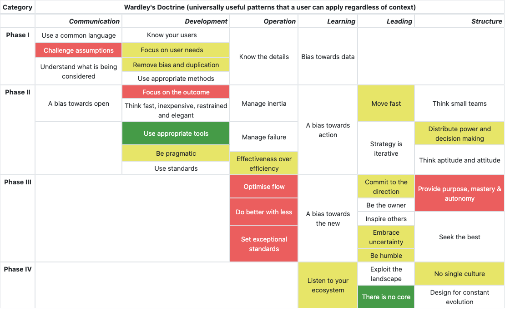
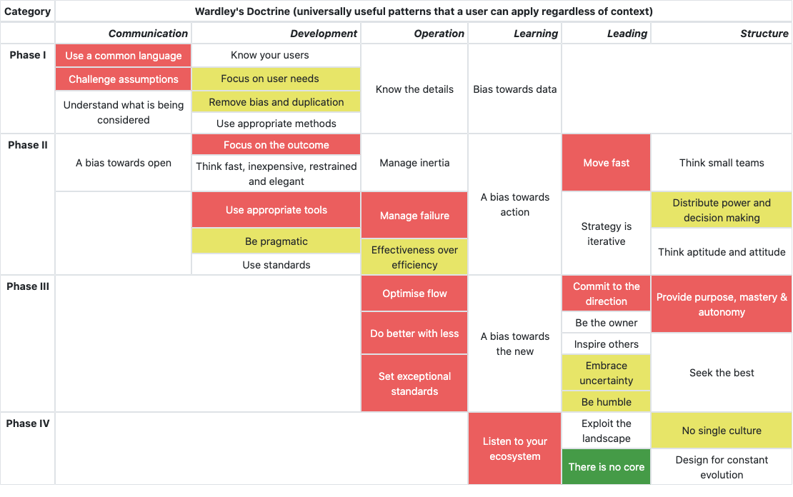
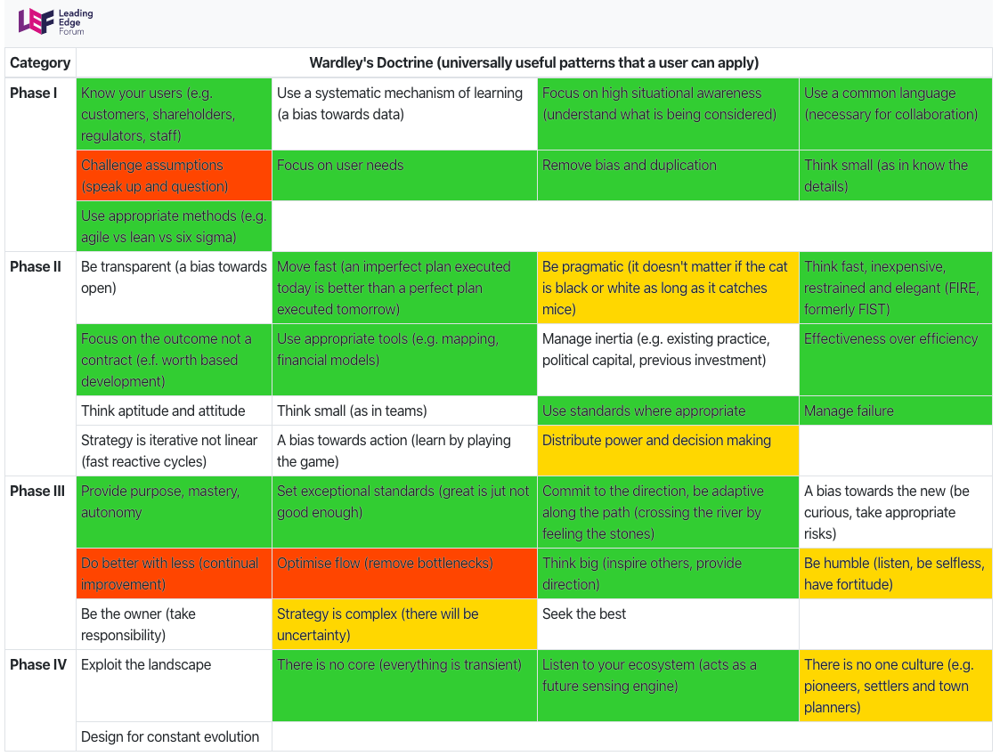

# Doctrine

> ## 📦 This tool has moved
>
> The doctrine assessment tool has been **rebuilt as a framework-free web component** and now lives at **[doctrine2.kda.zone](https://doctrine2.kda.zone)**. This React version is archived, and `doctrine.wardleymaps.com` redirects to the new home.
>
> The rebuild was an experiment in how well an AI coding agent handles legacy software — porting this Create React App into a completely different, framework-free engine — done with [Claude](https://claude.com/claude-code). It lives in [cdaniel/personal-presence-os](https://github.com/cdaniel/personal-presence-os).

---

A very simple tool for visualising how competitive is the company in the light of Simon Wardley's Doctrine.

You can navigate using ```Tab``` and use keys ```1```,```2``` & ```3``` to change your evaluation.

---

 If you are like this:
 
 
 
 
 And your competition is like this:
 
 
 
 you have nothing to worry about. But if your competitor is like this:
 
 
 
 they will run circles around you.
 
 Learn more at https://learn.wardleymaps.com!